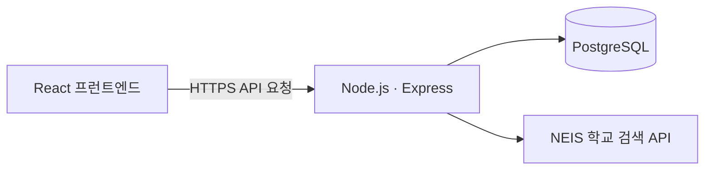

# 모아 · 수행평가 일정 API

> **학생과 학교가 함께 사용하는 수행평가 일정 서비스의 백엔드**

이 저장소는 모아 웹사이트에 필요한 API를 제공합니다. 학교·학급·과목과 수행평가 일정을 PostgreSQL에 저장하고, 학생의 일정 등록·수정 신청과 학교 관리자의 검토 과정을 처리합니다.

<p align="center">
  <a href="https://jinn-0901.github.io/assessment-calendar-web/"><strong>모아 웹사이트 열기 →</strong></a>
  &nbsp; · &nbsp;
  <a href="https://assessment-calendar-server.onrender.com/api/health">API 상태 확인</a>
</p>

---

## 한눈에 보기

| 항목 | 내용 |
| --- | --- |
| 웹사이트 | [모아 수행평가 통합 일정표](https://jinn-0901.github.io/assessment-calendar-web/) |
| API 기본 주소 | [https://assessment-calendar-server.onrender.com](https://assessment-calendar-server.onrender.com) |
| 상태 확인 | [`GET /api/health`](https://assessment-calendar-server.onrender.com/api/health) |
| 프런트엔드 저장소 | [assessment-calendar-web](https://github.com/jinn-0901/assessment-calendar-web) |
| 백엔드 저장소 | [assessment-calendar-server](https://github.com/jinn-0901/assessment-calendar-server) |
| 런타임 | Node.js 20 이상 |
| 주요 기술 | Express · PostgreSQL |

## 기능

- 학교·학급·과목 및 수행평가 일정 조회·관리
- 학생의 일정 등록·수정 신청 접수
- 학교별 관리자 인증과 신청 승인·반려
- NEIS 교육정보 개방 API를 통한 학교 검색
- PostgreSQL 데이터 저장
- 매년 3월, 지난 학년도 종료 일정 자동 정리

### 신청과 공개 일정

학생이 제출한 일정 등록·수정 신청은 관리자가 승인하기 전까지 공개 일정에 반영되지 않습니다. 관리자가 직접 등록한 일정은 즉시 공개됩니다. 자동 정리 작업은 승인 대기 중인 신청을 지우지 않으며, 대기 신청이 연결된 일정도 삭제 대상에서 제외합니다.

## 아키텍처



- **Express API:** 요청 검증, 일정 처리, 관리자 인증 및 응답을 담당합니다.
- **PostgreSQL:** 서비스의 영속 데이터와 세션 정보를 저장합니다.
- **NEIS API:** 학교 검색에 사용되며 API 키는 백엔드 환경 변수로 관리합니다.

## 기술 스택

- Node.js 20+
- Express 4
- PostgreSQL 및 `pg`
- Express Session
- `connect-pg-simple` 세션 저장소
- NEIS 교육정보 개방 API

## 로컬에서 실행하기

### 준비물

- Node.js 20 이상
- PostgreSQL 데이터베이스
- 필요한 서버 환경 변수

### 1. 저장소 내려받기

```bash
git clone https://github.com/jinn-0901/assessment-calendar-server.git
cd assessment-calendar-server
npm install
```

### 2. 환경 변수 설정

호스팅 환경의 환경 변수 설정 또는 로컬 전용 환경 설정을 통해 다음 값을 제공합니다.

| 변수 | 설명 |
| --- | --- |
| `DATABASE_URL` | PostgreSQL 연결 문자열 |
| `SESSION_SECRET` | 운영 환경에서 32자 이상인 무작위 비밀값 |
| `ADMIN_SETUP_KEY` | 운영 환경에서 32자 이상인 무작위 최초 설정용 비밀 키 |
| `NODE_ENV` | 배포 시 `production` |
| `FRONTEND_URL` | 허용할 프런트엔드 origin |
| `FRONTEND_URLS` | 추가로 허용할 origin 목록. 여러 주소는 쉼표로 구분 |
| `NEIS_API_KEY` | NEIS 교육정보 개방 포털에서 발급한 API 키 |

프런트엔드 origin은 끝에 슬래시를 붙이지 않는 형식으로 설정합니다. `FRONTEND_URLS`를 사용한다면 실제로 허용할 주소만 넣으세요.

NEIS API 키는 [NEIS 교육정보 개방 포털](https://open.neis.go.kr/portal/guide/apiGuidePage.do)에서 발급할 수 있습니다. 데이터베이스 주소와 비밀 키는 저장소에 커밋하지 마세요.

### 3. 데이터베이스 준비

새 데이터베이스라면 `schema.sql`을 한 번 실행합니다. 이미 데이터가 있는 데이터베이스라면 초기화하지 말고, 기존 스키마와 마이그레이션 파일을 검토한 뒤 필요한 변경만 적용하세요.

서버 시작 시 일부 호환성 컬럼과 인덱스가 자동으로 준비됩니다. 기존 데이터베이스에 스키마 파일을 무작정 다시 실행하거나, 데이터를 지우는 방식으로 초기화하지 마세요.

### 4. 서버 실행

```bash
npm start
```

파일 변경을 감지하는 개발 모드:

```bash
npm run dev
```

서버 상태 확인 경로는 `GET /api/health`입니다.

## 주요 API

API 기본 주소 뒤에 아래 경로를 붙여 요청합니다.

| 메서드 | 경로 | 용도 |
| --- | --- | --- |
| `GET` | `/api/health` | 서버 상태 확인 |
| `GET` | `/api/me` | 현재 인증 상태 확인 |
| `POST` | `/api/admin/registration-codes/bootstrap` | 운영자 인증 후 최초 등록 코드 발급 |\n| `POST` | `/api/admin/register` | 일회용 코드로 학교 관리자 등록 |
| `POST` | `/api/admin/login` | 관리자 로그인 |
| `POST` | `/api/admin/logout` | 관리자 로그아웃 |
| `GET` | `/api/admin/requests` | 학교의 신청 목록 조회 |
| `POST` | `/api/admin/requests/:id/decision` | 신청 승인 또는 반려 |
| `GET`, `POST` | `/api/schools` | 학교 조회·등록 |
| `GET`, `POST` | `/api/schools/:schoolId/classes`, `/api/classes` | 학급 조회·등록 |
| `GET`, `POST` | `/api/schools/:schoolId/subjects`, `/api/subjects` | 과목 조회·등록 |
| `GET`, `POST` | `/api/assessments` | 일정 조회·등록 |
| `PUT`, `DELETE` | `/api/assessments/:id` | 일정 수정·삭제 |

관리자 API는 인증이 필요합니다. 요청 본문과 인증 방식의 상세 동작은 실제 서버 구현을 기준으로 확인하세요.

## 학교 관리자 최초 설정

1. 웹사이트에서 나이스 검색으로 학교를 등록합니다.
2. 서버 환경 변수에 `ADMIN_SETUP_KEY`를 설정합니다.
3. `GET /api/schools` 응답에서 해당 학교의 ID를 확인합니다.
4. 운영자 키로 해당 학교의 일회용 등록 코드를 발급합니다.
5. 발급된 코드를 사용해 관리자 계정을 등록합니다.

```bash
# 1. 운영자 전용 일회용 등록 코드 발급
curl -X POST "$API_URL/api/admin/registration-codes/bootstrap" \
  -H "Content-Type: application/json" \
  -d '{"setupKey":"YOUR_ADMIN_SETUP_KEY","schoolId":1}'

# 2. 위 응답의 registrationCode를 사용해 관리자 등록
curl -X POST "$API_URL/api/admin/register" \
  -H "Content-Type: application/json" \
  -d '{"schoolId":1,"registrationCode":"PASTE_ONE_TIME_CODE","password":"YOUR_LONG_ADMIN_PASSWORD"}'
```

관리자 비밀번호는 최소 12자여야 합니다. 등록 코드는 24시간 동안 유효하며 한 번만 사용할 수 있습니다. 실제 설정 키, 등록 코드 또는 비밀번호를 문서·채팅·커밋에 공개하지 마세요.

## 연간 일정 자동 정리

서버는 한국 시간(`Asia/Seoul`)을 기준으로 매년 3월 1일 이후의 정리 실행 날짜를 확인합니다.

- 3월 1일이 주말이면 3·1절 대체공휴일을 고려해 다음 평일까지 건너뜁니다.
- 해당 연도 3월 1일보다 **종료일이 앞선** 수행평가만 정리 대상입니다.
- 3월 1일 당일 또는 이후에 종료되는 일정은 유지됩니다.
- 승인 대기 신청은 삭제하지 않습니다. 대기 신청이 연결된 수행평가 일정 역시 삭제 대상에서 제외합니다.
- 학년도별 실행 기록으로 같은 연도의 중복 정리를 방지합니다.
- 이 기능을 해당 연도의 실행 예정일이 지난 뒤 처음 설치하면, 그해의 기존 일정을 즉시 소급 삭제하지 않고 다음 학년도 정리부터 시작합니다.

정리 작업은 백엔드 프로세스가 실행 중일 때 확인됩니다. 호스팅 서비스가 중지된 동안에는 작업이 실행되지 않으며, 이미 초기화된 서비스가 다시 시작되면 실행 여부를 확인합니다. 운영 환경에 반영된 뒤에는 서버 로그와 데이터베이스를 확인하세요.

## 배포

이 프로젝트의 현재 API 배포 주소는 Render입니다. 배포 시 다음 항목을 확인하세요.

1. Node.js 20 이상 환경
2. `npm install` 및 `npm start`
3. PostgreSQL 연결 문자열과 필수 환경 변수
4. 프런트엔드 origin 및 관리자 세션 동작
5. `/api/health` 응답과 서버 로그

무료 호스팅 환경은 절전이나 재시작이 발생할 수 있습니다. 정해진 시각에 반드시 실행되어야 하는 작업이 있다면 호스팅의 실행 정책과 스케줄 작업 지원 여부도 별도로 확인해야 합니다.

## 문제 해결

- **데이터베이스 연결 오류:** `DATABASE_URL`, 네트워크 접근, 데이터베이스 상태를 확인합니다.
- **브라우저에서 API를 호출할 수 없음:** 프런트엔드 origin과 `FRONTEND_URL` 또는 `FRONTEND_URLS` 설정을 확인합니다.
- **관리자 로그인이 유지되지 않음:** 세션 비밀값, 쿠키 및 브라우저의 요청 정보를 확인합니다.
- **학교 검색 실패:** `NEIS_API_KEY`와 백엔드 로그를 확인합니다.
- **자동 정리가 실행되지 않음:** 서버가 실행 중인지, 한국 시간 기준 날짜가 지났는지, `assessment_cleanup_runs`에 해당 연도 기록이 있는지 확인합니다.

## 보안과 데이터 안전

- `DATABASE_URL`, `SESSION_SECRET`, `ADMIN_SETUP_KEY`, `NEIS_API_KEY`는 비밀 정보로 취급합니다.
- 실제 비밀번호와 인증 토큰을 커밋하거나 로그에 출력하지 마세요.
- 기존 데이터베이스의 스키마를 변경하기 전에는 백업과 외래 키 관계를 확인하세요.
- 자동 정리 기능을 변경할 때는 종료일 기준, 승인 대기 신청 보존, 중복 실행 방지 동작을 함께 검토하세요.

---

<p align="center"><sub>모아 · 수행평가 일정을 더 명확하게, 함께 관리하기</sub></p>


## 보안 운영 체크리스트

- 운영 환경에서는 충분히 길고 무작위인 `SESSION_SECRET`과 `ADMIN_SETUP_KEY`를 사용하고, 저장소·클라이언트 코드·로그에 기록하지 않습니다.
- 관리자 비밀번호는 bcrypt 해시로 저장합니다. bcrypt 입력 한계에 맞춰 비밀번호는 12자 이상, UTF-8 기준 72바이트 이내여야 합니다.
- 관리자 로그인·최초 등록 코드 발급·관리자 등록·비밀번호 변경에는 별도 요청 제한이 적용됩니다.
- 관리자 토큰은 24시간 후 만료됩니다. 비밀번호 변경, 관리자 재등록, 로그아웃은 인증 버전을 변경해 이전 토큰과 세션을 무효화합니다.
- 운영 환경의 변경 요청은 허용된 프런트엔드 출처를 검증합니다. `FRONTEND_URL`과 `FRONTEND_URLS`에는 origin만 등록하고, 경로나 와일드카드를 넣지 않습니다.
- 데이터베이스 마이그레이션에 실패하면 서버는 시작하지 않습니다.
- 보안은 코드만으로 완성되지 않습니다. Render 환경 변수, PostgreSQL 접근 권한·백업, GitHub 비밀 정보, 배포 설정 및 의존성 업데이트도 별도로 점검해야 합니다.
